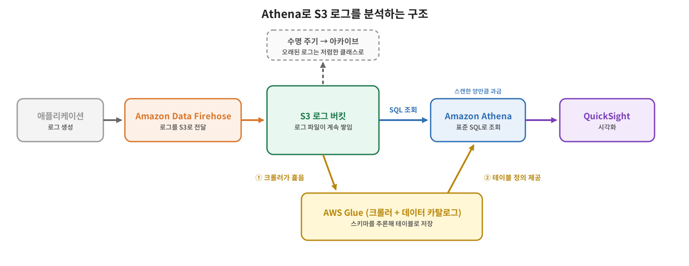

[지난 글](/2026/10/31/aws-s3-misc-features/)에서 서버 액세스 로깅으로 S3 요청 기록을 다른 버킷에 쌓는 방법을 봤다. 그런데 로그가 파일로만 쌓여 있으면 읽기가 어렵다. 이번 글에서는 S3에 쌓인 데이터를 SQL로 바로 조회하는 **Amazon Athena** 를 맛보기로 살펴본다. 자세한 실습은 Glue와 함께 따로 다룰 예정이라, 여기서는 개념과 구조, 과금, 알아 둘 주의점에 집중한다.

## S3에 쌓인 로그를 서버 없이 SQL로 조회한다

Amazon Athena는 **S3에 있는 데이터를 표준 SQL로 분석하는 대화형 쿼리 서비스**다. S3 버킷을 데이터베이스처럼 조회하되, 데이터를 어디로 옮기거나 적재할 필요가 없다. 서버리스라서 프로비저닝하거나 관리할 인프라가 없고, **실행한 쿼리에 대해서만 비용**을 낸다. 규모가 큰 데이터에도 쿼리를 병렬로 실행하며 자동으로 확장된다.

대표적인 쓰임새는 S3에 쌓인 로그를 분석하는 것이다. AWS 문서가 예로 드는 것만 해도 웹·애플리케이션 로그, CloudTrail, CloudFront, ELB/ALB 로그, VPC 흐름 로그 등이 있다. Redshift에 적재하기 전에 S3의 스테이징 데이터를 확인하거나, 정형 메타데이터에서 필요한 정보를 뽑는 데도 쓴다. 반대로 엔터프라이즈 리포팅·BI는 Redshift, 아주 큰 데이터의 ETL은 EMR이나 Glue, 트랜잭션 처리는 RDBMS가 맞고 Athena가 대신할 수 있는 영역이 아니다.

## 쿼리 비용은 스캔한 데이터 양이 정한다

Athena는 쿼리가 **스캔한 데이터 양**에 따라 과금된다. AWS 빅데이터 분석 백서 기준으로 TB당 5달러이고, 바이트 단위로 계산해 MB 단위로 올림하며 쿼리당 최소 10MB가 적용된다. 이 백서 페이지에는 과거 자료라는 표시가 있어서 금액은 현재 [Athena 요금 페이지](https://aws.amazon.com/athena/pricing/)에서 다시 확인해야 한다.

- 테이블 생성·삭제 같은 DDL 문은 무료다.
- 실패한 쿼리는 과금되지 않고, 취소한 쿼리는 그때까지 스캔한 양만큼 과금된다.
- 데이터를 **압축·파티셔닝하고 Parquet, ORC 같은 컬럼 기반 형식**으로 바꾸면 스캔량이 줄어 쿼리 비용을 30~90% 절감할 수 있다고 문서는 설명한다.

스캔량이 곧 비용이라는 점 때문에, "쿼리 몇 번 해 보는 것"은 비용이 크지 않지만 큰 로그 전체를 반복해서 훑는 쿼리는 부담이 될 수 있다.

## 스키마는 Glue 크롤러가 대신 만들어 준다

Athena가 SQL로 조회하려면 S3의 파일이 어떤 칼럼으로 이뤄져 있는지 알아야 한다. 이 스키마 정보를 **AWS Glue 데이터 카탈로그**에 테이블로 저장해 두는데, S3를 직접 훑어 스키마를 추론하고 테이블을 만들어 주는 것이 **Glue 크롤러**다. 크롤러가 하는 일은 다음 세 가지다.

1. 데이터를 분류해 형식, 스키마, 속성을 판단한다(JSON, CSV, Avro 같은 흔한 형식은 기본 분류기가 인식한다).
2. 데이터를 테이블이나 파티션 단위로 묶는다.
3. 그 메타데이터를 데이터 카탈로그에 쓴다. 이후 실행하면 새로 생기거나 바뀐 파일을 찾아 반영한다.

Athena에서 테이블은 **하나의 S3 접두사와 그 아래의 모든 객체**에 대응한다. 그래서 같은 접두사 아래에 스키마가 서로 다른 파일이 섞여 있으면 Athena는 이를 별개 테이블로 보지 않고, 쿼리 결과가 0건으로 나올 수 있다. 문서는 이를 피하려면 테이블별로 크롤러의 포함 경로(Include path)를 따로 지정하라고 안내한다. `year=2026/month=11/day=04` 같은 폴더 구조에서 스키마가 같다면 크롤러가 하나의 테이블에 파티션으로 묶어 주기도 한다.

## 로그가 쌓여서 차트가 되기까지

강의에서 소개한 샘플 아키텍처는 이렇다. 애플리케이션이 만든 로그를 **Amazon Data Firehose**가 받아 S3로 전달한다. 로그가 S3에 계속 쌓이면 Glue 크롤러가 스키마를 만들고, Athena가 그 스키마로 로그를 조회한다. 분석 결과는 QuickSight 같은 시각화 서비스로 보여 줄 수 있다. 로그가 오래 쌓여 비용이 늘면 [수명 주기 규칙](/2026/10/22/aws-s3-lifecycle/)으로 일정 기간 뒤 아카이브 스토리지 클래스로 옮기면 된다.

Firehose는 2024년 2월에 Amazon Kinesis Data Firehose에서 **Amazon Data Firehose** 로 이름이 바뀌었으므로, 예전 자료에서 Kinesis Data Firehose로 적힌 것과 같은 서비스다.

실습은 다음 순서로 진행했다. 로그 버킷을 만들어 로그 파일을 올리고, Glue 크롤러로 그 버킷의 스키마를 생성한 다음, Athena를 설정해서 S3를 쿼리한다. 데이터가 적은 데모라 비용이 많이 나오지 않지만 약간의 비용은 발생하므로, 직접 해 볼 때는 이 점을 염두에 두면 된다.

## 용어 정리

| 용어 | 설명 |
|---|---|
| **Amazon Athena** | S3 데이터를 표준 SQL로 조회하는 서버리스 대화형 쿼리 서비스. 스캔량 기준 과금 |
| **AWS Glue** | 데이터 통합 서비스. 데이터 카탈로그와 크롤러, ETL을 제공 |
| **Glue 데이터 카탈로그** | 데이터베이스·테이블 같은 메타데이터를 저장하는 저장소 |
| **Glue 크롤러** | 데이터를 훑어 스키마를 추론하고 카탈로그에 테이블을 생성·갱신하는 기능 |
| **파티셔닝** | 데이터를 폴더 단위로 나눠 필요한 부분만 스캔하게 하는 방식 |
| **Parquet / ORC** | 필요한 칼럼만 읽을 수 있는 컬럼 기반 파일 형식 |
| **Amazon Data Firehose** | 스트리밍 데이터를 S3 등으로 전달하는 서비스. 옛 이름은 Kinesis Data Firehose |
