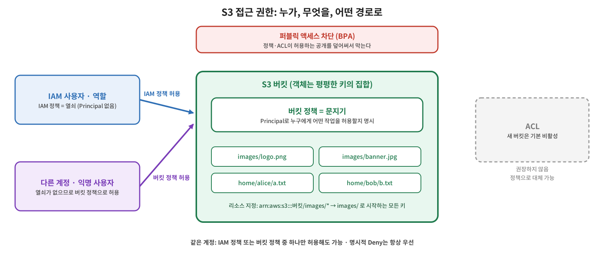

S3 버킷은 만들면 기본적으로 비공개다. [정적 웹 호스팅 글](/2026/10/29/aws-s3-static-hosting/)에서는 공개 읽기를 허용하는 버킷 정책을 붙였는데, 이번 글에서는 그 정책이 어떤 구조인지부터 시작해서 S3의 권한 관리 방법 전체를 정리한다. IAM 정책과 버킷 정책은 무엇이 다르고 언제 어느 쪽을 쓰는지, ACL은 왜 더 이상 권장되지 않는지, 정책을 쓰려면 S3의 키 구조를 왜 알아야 하는지를 다룬다.



## 개념: IAM 정책과 버킷 정책

S3 권한을 관리하는 방법은 크게 세 가지다. 그중 현재 실제로 쓰는 것은 앞의 두 가지다.

- **IAM 정책(자격 증명 기반 정책):** IAM 사용자, 그룹, 역할에 붙여서 S3에 대한 권한을 허용하거나 거부한다.
- **버킷 정책(리소스 기반 정책):** 버킷 자체에 붙여서, 어떤 주체가 그 버킷에 무엇을 할 수 있는지 정한다.
- **ACL:** 객체·버킷 단위의 오래된 권한 방식. 아래에서 따로 다룬다.

강의의 비유가 이해하기 쉽다. IAM 정책은 **열쇠**다. 문에 들어가려는 사람이 쥐고 있다. 버킷 정책은 **문지기**다. 문에 붙어서 누가 들어오는지, 들어온 사람이 무엇을 할 수 있는지를 가린다.

둘을 구분하는 가장 큰 단서는 **Principal(주체)** 요소다. IAM 정책은 어떤 사용자·역할에 붙어 있으니 "누가"가 이미 정해져 있어서 Principal을 쓰지 않는다. 반대로 버킷 정책은 누가 들어올지 모르기 때문에 "누구에게 적용되는지"를 정책 안에 명시한다. IAM 사용자일 수도, 다른 계정의 사용자일 수도, 익명 사용자일 수도 있다. 정적 호스팅 글에서 본 `"Principal": "*"` 는 모든 사람, 즉 익명 사용자까지 포함한다는 뜻이다.

버킷 정책은 다음과 같은 특징이 있다.

- 버킷 소유자만 붙일 수 있다.
- JSON 기반 IAM 정책 언어를 쓰고, 요청자, S3 작업, 리소스, 요청 조건(예: 출발지 IP)에 따라 허용하거나 거부할 수 있다.
- 버킷 소유자가 소유한 객체에만 적용된다. 다른 계정이 소유한 객체에는 적용되지 않는다.
- 수명 주기 규칙이 수행하는 삭제·전환은 버킷 정책으로 막을 수 없다. 모든 주체에 모든 작업을 거부하는 정책이 있어도 [수명 주기](/2026/10/22/aws-s3-lifecycle/) 설정은 정상적으로 동작한다.

### 언제 어느 쪽을 쓰나

강의에서 제시한 기준은 이렇다.

| 구분 | IAM 정책 | 버킷 정책 |
|---|---|---|
| 붙는 곳 | 사용자, 그룹, 역할 | 버킷 |
| Principal | 없음 | 있음 |
| 적합한 경우 | 같은 계정의 주체에게 S3, EC2, SQS 등 여러 서비스 권한을 함께 관리 | 익명 사용자나 다른 계정의 주체에게 권한을 주거나, S3에 대한 권한을 버킷 쪽에서 한곳에 모아 관리 |

예를 들어 IAM 사용자가 수백 명일 때 각자에게 S3 권한을 일일이 붙이기보다, 버킷에 정책을 붙여 들어오는 주체를 구분해 권한을 주는 방식이 편할 수 있다.

### 같은 계정과 다른 계정에서의 평가

두 정책이 함께 있을 때 어떻게 판단하는지도 알아 두자. IAM 문서 기준으로 같은 계정 안에서는 규칙이 단순하다.

- **명시적 거부(Deny)는 항상 허용보다 우선한다.**
- 같은 계정 안에서는 **IAM 정책과 버킷 정책 중 하나만 허용해도** 요청이 허용된다.
- 어디에도 허용이 없으면 기본적으로 거부된다.

반면 **다른 계정**의 주체가 접근할 때는 S3 문서에 따라 주체가 속한 계정과 리소스를 소유한 계정 양쪽의 허가가 필요하다. 즉 상대 계정 사용자가 우리 버킷을 쓰게 하려면 우리 쪽 버킷 정책에서 허용하는 것만으로는 부족하고, 그 사용자의 계정에서도 권한을 부여해야 한다.

## 개념: ACL은 쓰지 않는 것이 좋다

**ACL(Access Control List)** 은 버킷이나 객체 단위로 읽기·쓰기 권한을 주는 오래된 방식이다. 리눅스의 ACL과 비슷하게 소유자와 권한이 나열되는 구조다. 지금은 AWS가 대부분의 경우 사용하지 않기를 권장한다.

그 배경에는 **객체 소유권(Object Ownership)** 설정이 있다. 세 가지 값이 있고, 새 버킷의 기본값은 **Bucket owner enforced** 다.

| 설정 | ACL | 설명 |
|---|---|---|
| **Bucket owner enforced** (기본값) | 비활성화 | 버킷 소유자가 모든 객체를 소유하고 정책으로만 접근을 관리 |
| Bucket owner preferred | 활성화 | `bucket-owner-full-control` ACL로 올린 객체는 버킷 소유자가 소유 |
| Object writer | 활성화 | 객체를 올린 계정이 그 객체를 소유 |

ACL이 비활성화되면 ACL 설정 요청은 실패하고, 접근은 IAM 정책, 버킷 정책, VPC 엔드포인트 정책, Organizations SCP 등으로만 제어된다. AWS는 개별 객체 단위로 접근을 제어해야 하는 경우가 아니라면 ACL을 끄고, 다른 계정과 데이터를 공유할 때도 버킷 정책을 쓰라고 안내한다. 강의에서 "ACL은 활성화한 뒤에 적용할 수 있다"고 한 것이 이 설정을 말한다.

## 개념: S3의 키 구조와 정책의 범위

콘솔에서는 `world/south-korea/seoul/guro/map.json`처럼 폴더 안에 폴더가 있는 구조로 보인다. 하지만 S3 내부에는 계층 구조가 없다. 버킷 안의 객체는 **평평한(flat) 키의 집합**이고, `/`는 콘솔과 API가 화면에 폴더처럼 보여 주기 위한 구분자일 뿐이다. 위 예시에서 버킷 이름을 제외한 `world/south-korea/seoul/guro/map.json` 전체가 하나의 키다.

콘솔에서 폴더를 만들면 키 끝에 `/`가 붙은 0바이트 객체(예: `photos/`)가 만들어지고, 키가 `/`로 끝나는 객체는 콘솔에서 폴더로 표시된다.

이 구조가 중요한 이유는 정책의 리소스 범위를 접두사로 지정하기 때문이다. 예를 들어 리소스를 `arn:aws:s3:::my-bucket/images/*`로 쓰면 `images/`로 시작하는 모든 객체가 대상이 된다. 한 가지 더 알아 둘 것은 **버킷 단위 작업(`s3:ListBucket`)은 버킷 ARN, 객체 단위 작업(`s3:GetObject` 등)은 `/*`가 붙은 객체 ARN에 지정**한다는 점이다. 이는 아래 홈 디렉터리 정책에서 그대로 나타난다.

## 개념: 퍼블릭 액세스 차단

새 버킷은 기본적으로 공개되지 않는다. 그래도 실수로 공개되는 일을 막기 위해 S3에는 **퍼블릭 액세스 차단(Block Public Access, BPA)** 이 있다. 계정, 버킷, 액세스 포인트 단위로 적용할 수 있고, 네 가지 설정(`BlockPublicAcls`, `IgnorePublicAcls`, `BlockPublicPolicy`, `RestrictPublicBuckets`)이 독립적으로 동작한다.

BPA는 정책이나 ACL이 허용하는 공개를 **덮어쓴다.** `BlockPublicPolicy`가 켜져 있으면 공개를 허용하는 버킷 정책은 저장되지 않는다. 여러 수준의 설정이 다르면 S3는 가장 제한적인 조합을 적용한다.

강의에서 헷갈리기 쉬운 부분이 하나 있었다. BPA를 끄는 것만으로는 퍼블릭 액세스 권한이 생기지 않는다. 끄는 것은 "정책이나 ACL이 허용한 공개를 막지 않겠다"는 뜻일 뿐이다. 실제로 공개하려면 BPA를 끄고 나서 공개 읽기를 허용하는 버킷 정책을 따로 붙여야 한다. 반대로 이미 공개 정책이 붙어 있는 버킷에서 BPA를 끄면 다시 공개된다.

## 실습: 사용자별 홈 디렉터리 만들기

데모에서는 두 가지를 했다. 먼저 IAM 사용자에게 S3 접근을 허용하는 IAM 정책을 붙여 접근시키고, 그다음 IAM 사용자의 접근을 허용하는 버킷 정책을 버킷에 붙여 접근시킨다. 이어서 Alice는 자기 폴더만, Bob은 자기 폴더만 볼 수 있는 **홈 디렉터리**를 만든다.

AWS IAM 문서에 이 패턴을 위한 예시 정책이 있다. 핵심은 정책 변수 `${aws:username}`이다. 요청하는 IAM 사용자 이름으로 치환되므로, 같은 정책 하나로 사용자마다 자기 이름의 폴더에만 접근하게 된다.

```json
{
  "Version": "2012-10-17",
  "Statement": [
    {
      "Sid": "S3ConsoleAccess",
      "Effect": "Allow",
      "Action": [
        "s3:GetAccountPublicAccessBlock",
        "s3:GetBucketAcl",
        "s3:GetBucketLocation",
        "s3:GetBucketPolicyStatus",
        "s3:GetBucketPublicAccessBlock",
        "s3:ListAccessPoints",
        "s3:ListAllMyBuckets"
      ],
      "Resource": "*"
    },
    {
      "Sid": "ListObjectsInBucket",
      "Effect": "Allow",
      "Action": "s3:ListBucket",
      "Resource": "arn:aws:s3:::<버킷-이름>",
      "Condition": {
        "StringLike": {
          "s3:prefix": ["", "home/", "home/${aws:username}/*"]
        }
      }
    },
    {
      "Effect": "Allow",
      "Action": "s3:*",
      "Resource": [
        "arn:aws:s3:::<버킷-이름>/home/${aws:username}",
        "arn:aws:s3:::<버킷-이름>/home/${aws:username}/*"
      ]
    }
  ]
}
```

앞의 키 구조 설명이 그대로 쓰인다. `ListBucket`은 버킷 ARN에 `s3:prefix` 조건으로 접두사를 제한하고, 객체에 대한 작업은 `home/<사용자 이름>/` 아래 객체 ARN으로 제한한다. 첫 번째 문장은 콘솔에서 버킷 목록을 보기 위한 권한이다.

이 정책은 **IAM 역할에는 쓸 수 없다.** 역할을 쓰면 `aws:username` 변수를 사용할 수 없기 때문이다. 사용자 단위로 폴더를 나누는 이 방식은 IAM 사용자에 한한다는 점에 유의한다.

## 용어 정리

| 용어 | 설명 |
|---|---|
| **IAM 정책** | 사용자·그룹·역할에 붙는 자격 증명 기반 정책. Principal 없음 |
| **버킷 정책** | 버킷에 붙는 리소스 기반 정책. Principal 있음, 버킷 소유자만 설정 |
| **Principal** | 정책이 적용되는 주체. `*`는 익명 사용자를 포함한 모든 사람 |
| **명시적 거부** | Deny 문. 어떤 허용보다도 우선 |
| **ACL** | 객체·버킷 단위 권한 목록. 새 버킷에서는 기본 비활성이며 사용을 권장하지 않음 |
| **Object Ownership** | 객체 소유자와 ACL 사용 여부를 정하는 설정. 기본값은 Bucket owner enforced |
| **키(Key)** | 버킷 안에서 객체를 식별하는 문자열 전체. 폴더 구조는 `/`로 표현한 화면상의 구분 |
| **퍼블릭 액세스 차단(BPA)** | 정책·ACL이 허용하는 공개를 덮어써서 막는 안전장치 |
| **정책 변수** | 요청 시점에 값으로 치환되는 변수. 예: `${aws:username}` |
