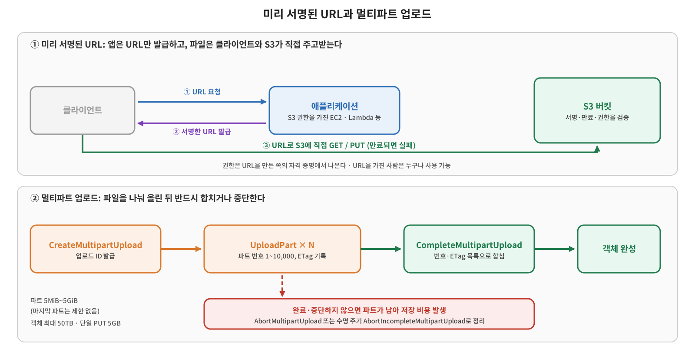

[권한 관리 글](/2026/11/06/aws-s3-access-control/)에서 S3 객체에 누가 접근할 수 있는지를 정책으로 정하는 방법을 봤다. 이번 글에서는 그 접근을 실제로 어떻게 안전하고 효율적으로 하는가를 다룬다. 파일을 올리고 내려받는 네 가지 방법을 비교하고, 그중 가장 헷갈리는 **미리 서명된 URL(Presigned URL)** 과 큰 파일을 나눠 올리는 **멀티파트 업로드**를 자세히 정리한다.



## 개념: 업로드와 다운로드 네 가지 방법

| 방법 | 쓰임새 |
|---|---|
| **AWS 웹 콘솔** | 사람이 직접 드래그해서 올리거나 선택해서 내려받을 때. 그동안 실습에서 쓴 방식 |
| **AWS SDK / CLI** | 애플리케이션이나 OS에서 S3와 직접 통신할 때. 접근 권한을 가진 IAM 사용자나 역할이 필요 |
| **일반 URL** | 버킷이나 객체가 퍼블릭으로 공개되어 있을 때. 다운로드만 가능하고 업로드는 불가능 |
| **미리 서명된 URL** | 비공개 객체를 임시로, 안전하게 공유할 때. 다운로드와 업로드 모두 가능 |

앞의 세 가지는 사용 사례가 분명하다. 마지막이 왜 필요한지는 문제를 먼저 보면 이해가 쉽다.

## 문제: 사용자에게 S3 접근 권한을 어떻게 줄 것인가

영상 공유 서비스를 만들었고, S3 버킷에 있는 영상을 사용자에게 보여 주고 싶다고 하자. 가장 단순한 방법은 IAM 사용자를 만들어 액세스 키와 시크릿 키를 사용자에게 주는 것이지만 문제가 많다.

- 사용자마다 IAM 사용자를 만들면 IAM 사용자 수에 할당량이 있어서 확장되지 않고, 가입할 때마다 만드는 것도 번거롭다.
- 키 하나를 모두가 공유하면 사용자별로 권한을 다르게 줄 수 없다. 모든 권한을 가진 키가 되기 때문이다.
- 키를 받은 사용자가 다른 사람에게 넘기는 것을 막을 수 없고, 만료 기간을 정하기도 어렵다.
- 유출되면 모두에게 새 키를 다시 배포해야 한다.

업로드에도 비슷한 비효율이 있다. 사용자가 500MB짜리 영상을 올릴 때 로드 밸런서 뒤의 웹 서버가 받아서 다시 S3로 올리게 하면, 웹 서버가 트래픽과 메모리를 쓰고 같은 데이터를 두 번 옮기게 된다. 클라이언트가 S3에 직접 올리면 웹 서버 부하가 없어지고 더 빠르지만, 그러려면 클라이언트에게 S3 권한이 있어야 한다. 이 문제를 풀어 주는 것이 미리 서명된 URL이다.

## 개념: 미리 서명된 URL

강의는 이렇게 비유했다. 삼촌이 은행에 가서 돈을 뽑아 오라고 시키면서, 도장과 통장을 주는 대신 **서명한 수표**를 준다. 은행원은 수표의 서명을 검증하고, 맞으면 삼촌의 권한으로 돈을 내준다. 심부름꾼은 삼촌의 권한을 직접 갖지 않고 수표만 들고 가면 된다. 미리 서명된 URL이 이 수표다.

권한이 있는 애플리케이션이 자기 자격 증명으로 서명해서 URL을 만들고 클라이언트에게 넘긴다. 클라이언트는 그 URL로 S3에 직접 요청하고, S3는 서명을 검증한 뒤 객체를 내려주거나 업로드를 받는다. 위 그림처럼 애플리케이션은 URL만 발급하면 되므로 파일 자체는 애플리케이션을 거치지 않는다.

AWS 문서 기준으로 정리하면 다음과 같다.

- 기본적으로 S3 객체는 비공개이고, 미리 서명된 URL은 **시간이 제한된 권한**을 준다. 다운로드(`GET`), 업로드(`PUT`), 메타데이터 조회(`HEAD`) 등에 쓸 수 있다.
- URL의 권한은 **생성한 사람의 자격 증명**에서 나온다. URL을 만든 사람이 그 작업을 할 권한이 없으면 URL은 만들어져도 동작하지 않고 `403 Forbidden`이 난다. 버킷 정책이 명시적으로 거부하는 경우도 마찬가지다. 생성자가 `PUT`만 가능하면 `PUT`만 되고, `GET`만 가능하면 `GET`만 된다.
- **URL을 가진 사람은 누구나** 만료 전까지 쓸 수 있고 재사용도 가능하다. 그래서 URL은 비밀번호처럼 다뤄야 한다(문서의 표현은 "bearer token"이다). 영상 공유 예시에서 사용자가 URL을 다른 사람에게 공유해도 만료 시간이 지나면 쓸 수 없다는 점이 만료의 의미다.
- 만료는 **요청 시점**에 확인한다. 이미 시작된 다운로드는 만료 시각을 넘겨도 계속되지만, 만료 후 다시 시작하면 실패한다.
- 업로드용 URL은 **업로드하는 사람에게 AWS 자격 증명이 필요 없다.** 같은 키의 객체가 있으면 덮어쓰고, URL을 만들 때 Content-Type을 지정했다면 업로드 요청도 같은 값을 써야 한다(다르면 서명 검증이 실패한다).

### 만료 시간

| 생성 방법·자격 증명 | 최대 유효 시간 |
|---|---|
| S3 콘솔 | 1분~12시간 |
| AWS CLI·SDK (IAM 사용자의 장기 자격 증명) | 최대 7일 |
| IAM 역할 세션 등 임시 자격 증명 | 자격 증명이 만료되면 함께 만료 |
| EC2 인스턴스 역할 자격 증명 | 보통 약 6시간 |

URL에 더 긴 만료를 지정했더라도, **서명에 쓴 자격 증명이 만료·삭제·비활성화되면 URL도 만료**된다. 실무에서 "분명히 7일로 만들었는데 몇 시간 만에 안 된다"면 임시 자격 증명으로 만든 것인지 먼저 확인할 일이다.

### 보안을 더 조이는 방법

URL의 서명이 만들어진 지 오래된 요청을 거부하는 버킷 정책을 쓸 수 있다. 문서의 예시는 서명이 10분을 넘은 미리 서명된 요청을 거부한다.

```json
{
  "Version": "2012-10-17",
  "Statement": [
    {
      "Sid": "Deny a presigned URL request if the signature is more than 10 min old",
      "Effect": "Deny",
      "Principal": { "AWS": "*" },
      "Action": "s3:*",
      "Resource": "arn:aws:s3:::<버킷-이름>/*",
      "Condition": {
        "NumericGreaterThan": { "s3:signatureAge": "600000" }
      }
    }
  ]
}
```

접근 경로는 `aws:SourceIp`나 VPC 엔드포인트 조건(`aws:SourceVpc`, `aws:SourceVpce`)으로 제한할 수 있다.

## 개념: 멀티파트 업로드

**멀티파트 업로드(Multipart Upload)** 는 하나의 파일을 여러 파트로 나눠 올리는 방식이다. 장점은 두 가지다.

- **속도:** 파트를 병렬로 올려 처리량을 높일 수 있다.
- **복구와 제어:** 100GB 파일을 통째로 올리다 99.9GB에서 연결이 끊기면 처음부터 다시 해야 한다. 파트로 나눠 두면 실패한 파트만 다시 올리면 되고, 어디까지 올렸는지 기록해 두었다가 이어서 올리는 것도 가능하다. 또 최종 크기를 모르는 상태에서 업로드를 시작할 수도 있다.

AWS는 객체가 **100MB 이상이면 멀티파트 업로드를 고려**하라고 안내한다. 단일 PUT은 최대 5GB까지만 가능하고, 멀티파트로는 객체 하나를 **최대 50TB**까지 올릴 수 있다. 파트 크기는 5MiB~5GiB(마지막 파트는 크기 제한 없음), 파트 수는 최대 10,000개다. 단점은 업로드 로직이 단일 업로드보다 복잡하고, 어떤 파트를 올렸는지 애플리케이션이 관리해야 한다는 점이다.

### 진행 과정

예를 들어 400MB 파일을 100MB씩 4개로 올린다고 하자.

1. **`CreateMultipartUpload`:** 멀티파트 업로드를 시작한다. S3가 **업로드 ID** 를 돌려준다. 객체 메타데이터는 이 단계에서 지정한다.
2. **`UploadPart`:** 각 파트를 올린다. 업로드 ID와 1~10,000 사이의 **파트 번호**를 함께 보내고, 응답으로 받는 **ETag**를 파트 번호와 함께 기록해 둔다. 같은 파트 번호로 다시 올리면 이전 파트를 덮어쓴다.
3. **`CompleteMultipartUpload`:** 업로드 ID와 파트 번호·ETag 목록을 보내면 S3가 파트 번호 순서대로 이어 붙여 하나의 객체로 만든다.

그래서 **두 번 이상 호출**해야 한다. 생성하고 파트를 올린 뒤 완료 요청을 하지 않으면 객체가 만들어지지 않는다. 100GB 파일을 100MB 파트로 나누면 API 호출이 약 1,002번(생성 1, 파트 1,000, 완료 1)이다.

### 주의: 끝나지 않은 업로드는 비용이 된다

완료하지도 중단하지도 않은 멀티파트 업로드의 파트는 S3에 남아 있고, **완료하거나 중단할 때까지 저장 비용이 청구된다.** 에러로 끊기거나 완료 요청을 빠뜨리면 눈에 보이지 않는 파트가 쌓이게 된다. 이를 막는 방법은 다음과 같다.

- `AbortMultipartUpload`로 중단하면 올라간 파트가 모두 삭제된다(진행 중인 파트 업로드가 끝난 뒤에 중단해야 전부 지워진다).
- 수명 주기 규칙의 `AbortIncompleteMultipartUpload` 동작으로 시작한 지 일정 일수가 지난 미완료 업로드를 자동으로 중단·삭제한다. "7일 후 삭제" 같은 규칙을 한 번 걸어 두면 매번 확인하지 않아도 된다. [수명 주기 글](/2026/10/22/aws-s3-lifecycle/)에서 본 것처럼 이 규칙에는 태그 필터를 쓸 수 없다.
- 현재 남아 있는 미완료 업로드의 양은 **S3 Storage Lens**의 무료 지표(미완료 멀티파트 업로드 바이트·개수, 7일 넘은 것)로 확인할 수 있다.

## 실습: 직접 구현해서 확인하기

데모에서는 백엔드와 프런트엔드를 직접 만들어 두 기능이 어떻게 동작하는지 보여 줬다. 백엔드는 서버리스 서비스인 Lambda 기반이고 프런트엔드는 React 클라이언트다. 소스 코드의 README에 설치 순서가 있고, AWS CLI와 프로파일 설정이 필요하다. 목적은 코드 자체가 아니라 미리 서명된 URL과 멀티파트 업로드가 각각 어떻게 동작하는지 확인하는 것이다.

## 용어 정리

| 용어 | 설명 |
|---|---|
| **미리 서명된 URL** | 생성자의 권한으로 시간이 제한된 접근을 허용하는 URL. 가진 사람은 누구나 사용 가능 |
| **bearer token** | 가진 사람이 곧 권한자가 되는 토큰. 미리 서명된 URL은 이처럼 다뤄야 함 |
| **멀티파트 업로드** | 큰 객체를 여러 파트로 나눠 올리는 방식. 파트 5MiB~5GiB, 최대 10,000개 |
| **업로드 ID** | 하나의 멀티파트 업로드를 식별하는 값. `CreateMultipartUpload`가 반환 |
| **파트 번호 / ETag** | 각 파트를 식별하는 번호와, 완료 요청에 함께 보내야 하는 응답 값 |
| **`CompleteMultipartUpload`** | 올린 파트를 하나의 객체로 합치는 호출. 하지 않으면 객체가 생기지 않음 |
| **`AbortIncompleteMultipartUpload`** | 미완료 업로드를 일정 일수 후 정리하는 수명 주기 동작 |
| **S3 Storage Lens** | 스토리지 사용량·활동 지표 도구. 미완료 멀티파트 업로드 지표를 무료로 제공 |
