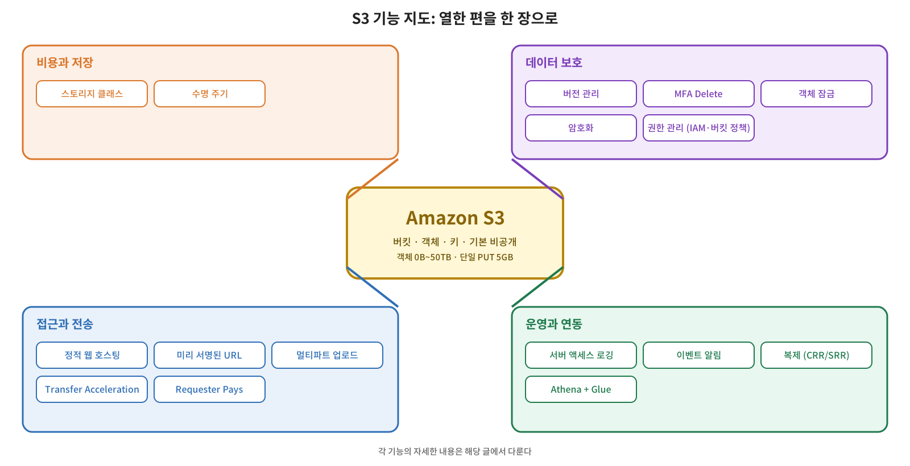

S3 파트에서 다룬 열한 편을 한 장으로 묶어 정리한다. 새로운 개념은 없고, 흩어진 기능을 지도로 만들어서 **어떤 문제에 어떤 기능을 쓰는지**를 한눈에 볼 수 있게 하는 것이 목적이다. 자세한 근거와 예외는 각 글에 있다. 순서대로 읽으면 다음과 같다.

1. [S3 소개](/2026/10/04/aws-s3-intro/) — 객체 스토리지, 버킷과 객체
2. [S3 기초](/2026/10/07/aws-s3-basics/) — 버킷 이름, 객체 크기, 키 구조
3. [스토리지 클래스](/2026/10/08/aws-s3-storage-classes/) — 접근 빈도별 클래스와 최소 보관 기간
4. [버전 관리와 객체 잠금](/2026/10/17/aws-s3-versioning-object-lock/) — 삭제·덮어쓰기 복구, MFA Delete, WORM
5. [수명 주기](/2026/10/22/aws-s3-lifecycle/) — 전환·삭제 자동화
6. [암호화](/2026/10/25/aws-s3-encryption/) — SSE-S3, SSE-KMS, SSE-C, 클라이언트 사이드
7. [정적 웹 호스팅](/2026/10/29/aws-s3-static-hosting/) — 웹사이트 엔드포인트, Route 53, CloudFront
8. [기타 기능](/2026/10/31/aws-s3-misc-features/) — 로깅, 이벤트 알림, 복제, Transfer Acceleration, Requester Pays
9. [Athena](/2026/11/05/aws-athena-s3-analysis/) — S3 데이터를 SQL로 분석
10. [권한 관리](/2026/11/06/aws-s3-access-control/) — IAM 정책, 버킷 정책, ACL, 퍼블릭 액세스 차단
11. [미리 서명된 URL과 멀티파트 업로드](/2026/11/07/aws-s3-presigned-url-multipart/) — 임시 공유와 큰 파일 업로드

## 전체 구조를 하나의 그림으로

기능은 네 묶음으로 나눌 수 있다. 가운데에 S3(버킷, 객체, 키)가 있고, 비용과 저장 방식, 데이터 보호, 접근과 전송, 운영과 연동이 둘러싼다.

객체가 들어오면 먼저 **저장 방식**이 정해진다. 스토리지 클래스로 접근 빈도에 맞는 비용을 고르고, 시간이 지나면 수명 주기 규칙이 아래 클래스로 옮기거나 지운다. 같은 객체는 **보호 기능**으로 감싼다. 버전 관리와 객체 잠금은 삭제와 덮어쓰기를 막고, 암호화는 저장된 데이터를, 권한 관리는 누가 접근하는지를 통제한다. 이렇게 보호된 객체를 **접근과 전송** 단계에서 서비스한다. 웹사이트로 공개하거나, 미리 서명된 URL로 임시 공유하거나, 멀티파트와 Transfer Acceleration으로 크고 먼 업로드를 처리한다. 마지막으로 **운영과 연동**이 이 모든 흐름을 기록하고 반응한다. 로깅과 이벤트 알림, 복제, Athena 분석이 여기에 속한다.

## 기본 구조: S3는 객체 스토리지다

S3는 파일을 디스크처럼 붙여서 쓰는 것이 아니라 HTTP API로 객체를 올리고 내려받는 **객체 스토리지**다([S3 소개](/2026/10/04/aws-s3-intro/)). 리전 안에 **버킷**을 만들고 그 안에 **객체**를 저장한다. 버킷 이름은 전 세계에서 유일해야 하고, 데이터는 버킷을 만든 리전 안에 저장된다. 객체는 0바이트부터 최대 50TB까지이고 단일 PUT으로는 5GB까지 올릴 수 있다([S3 기초](/2026/10/07/aws-s3-basics/)).

객체의 키는 평평한 문자열이고, 콘솔의 폴더 모양은 `/`로 구분해서 보여 주는 화면상의 구분일 뿐이다([권한 관리](/2026/11/06/aws-s3-access-control/)). 그리고 버킷과 객체는 기본적으로 비공개다.

## 비용과 저장 방식

접근 빈도에 맞는 클래스를 고르고, 시간이 지나면 규칙으로 자동으로 옮기거나 지우는 영역이다.

| 기능 | 해결하는 문제 | 기억할 점 | 글 |
|---|---|---|---|
| **스토리지 클래스** | 접근 빈도에 맞춰 저장 비용을 줄인다 | Standard가 기준. IA는 최소 30일·128KB 과금, Glacier는 Instant·Flexible 90일, Deep Archive 180일. 패턴을 모르면 Intelligent-Tiering | [스토리지 클래스](/2026/10/08/aws-s3-storage-classes/) |
| **수명 주기** | 수많은 객체의 전환·삭제를 자동화한다 | 전환은 폭포수 방향으로만 가능. 128KB 미만은 기본적으로 전환되지 않음. 이전 버전 정리와 미완료 멀티파트 정리도 담당 | [수명 주기](/2026/10/22/aws-s3-lifecycle/) |

## 데이터 보호

실수로 지우거나 덮어쓰는 사고, 유출, 잘못된 접근을 막는 영역이다.

| 기능 | 해결하는 문제 | 기억할 점 | 글 |
|---|---|---|---|
| **버전 관리** | 삭제·덮어쓰기에서 복구한다 | 한번 켜면 끌 수 없고 일시 중지만 가능. 삭제해도 삭제 마커만 얹히므로 이전 버전 비용이 계속 나옴 | [버전 관리와 객체 잠금](/2026/10/17/aws-s3-versioning-object-lock/) |
| **MFA Delete** | 영구 삭제에 추가 인증을 요구한다 | 루트 사용자가 CLI·API로만 설정. 수명 주기와 함께 쓸 수 없음 | 위와 같음 |
| **객체 잠금** | 삭제·덮어쓰기를 막는다(WORM) | 버전 관리 필수. 규정 준수 모드는 루트도 못 지움. 적용 전에 거버넌스 모드로 테스트 | 위와 같음 |
| **암호화** | 전송 중·저장 시 데이터를 보호한다 | SSE-S3가 기본값(2023년 1월부터)이고 끌 수 없음. SSE-KMS는 키 단위 권한 분리·감사. SSE-C는 2026년 4월부터 기본 차단 | [암호화](/2026/10/25/aws-s3-encryption/) |
| **권한 관리** | 누가 무엇을 할 수 있는지 정한다 | IAM 정책은 열쇠, 버킷 정책은 문지기. ACL은 새 버킷에서 기본 비활성. 퍼블릭 액세스 차단이 공개를 덮어씀 | [권한 관리](/2026/11/06/aws-s3-access-control/) |

## 접근과 전송

파일을 서비스하거나 공유하고, 안정적으로 올리고 내려받는 영역이다.

| 기능 | 해결하는 문제 | 기억할 점 | 글 |
|---|---|---|---|
| **정적 웹 호스팅** | 서버 없이 웹사이트를 서비스한다 | 웹사이트 엔드포인트는 HTTP만, 공개 읽기만 지원. 도메인 연결은 Route 53 별칭, HTTPS는 CloudFront | [정적 웹 호스팅](/2026/10/29/aws-s3-static-hosting/) |
| **미리 서명된 URL** | 비공개 객체를 임시로 공유하고 클라이언트가 직접 올리게 한다 | URL을 가진 사람은 누구나 사용 가능. 만료는 서명에 쓴 자격 증명의 수명을 넘지 못함 | [미리 서명된 URL·멀티파트](/2026/11/07/aws-s3-presigned-url-multipart/) |
| **멀티파트 업로드** | 큰 파일을 병렬로 올리고 실패한 부분만 다시 올린다 | 100MB 이상이면 고려. 완료·중단하지 않으면 파트 비용 발생 | 위와 같음 |
| **Transfer Acceleration** | 먼 거리의 업로드·다운로드 경로를 최적화한다 | 가까운 CloudFront 엣지를 경유하는 전송 경로 최적화이고 캐싱 CDN이 아님. 버킷 이름에 마침표 불가 | [기타 기능](/2026/10/31/aws-s3-misc-features/) |
| **Requester Pays** | 내려받기 비용을 요청자에게 넘긴다 | 익명 접근 불가. 저장 비용은 항상 소유자 부담 | 위와 같음 |

## 운영과 연동

기록하고, 반응하고, 복제하고, 분석하는 영역이다.

| 기능 | 해결하는 문제 | 기억할 점 | 글 |
|---|---|---|---|
| **서버 액세스 로깅** | 버킷에 대한 요청을 기록한다 | 대상 버킷은 같은 리전·계정, 기본 암호화는 SSE-S3. 최선 노력 전달이라 누락·지연 가능 | [기타 기능](/2026/10/31/aws-s3-misc-features/) |
| **이벤트 알림** | 객체 생성·삭제에 자동으로 반응한다 | SNS, SQS, Lambda, EventBridge로 전달. 같은 버킷에 결과를 쓰면 반복 실행 위험 | 위와 같음 |
| **복제** | 다른 리전·계정에 사본을 둔다 | 양쪽 버저닝 필수. 기존 객체는 Batch Replication 필요. 버전 ID 지정 영구 삭제는 복제되지 않음 | 위와 같음 |
| **Athena** | S3 데이터를 SQL로 분석한다 | 스캔량 기준 과금. Glue 크롤러가 스키마를 만듦. 압축·파티셔닝·컬럼 형식으로 비용 절감 | [Athena](/2026/11/05/aws-athena-s3-analysis/) |

## 상황별 선택 가이드

| 상황 | 쓸 기능 |
|---|---|
| 자주 보지 않는 데이터의 저장 비용을 줄이고 싶다 | Standard-IA나 Glacier 계열 + 수명 주기 |
| 접근 패턴을 알 수 없다 | Intelligent-Tiering |
| 실수로 지우거나 덮어쓴 파일을 되살리고 싶다 | 버전 관리 (이전 버전은 수명 주기로 정리) |
| 법적으로 일정 기간 삭제를 막아야 한다 | 객체 잠금 규정 준수 모드 (먼저 거버넌스 모드로 테스트) |
| 키 사용 이력을 감사하고 권한을 나누고 싶다 | SSE-KMS |
| AWS를 포함한 제3자에게도 평문을 숨기고 싶다 | 클라이언트 사이드 암호화 |
| 같은 계정 사용자에게 여러 서비스 권한을 주고 싶다 | IAM 정책 |
| 익명 사용자나 다른 계정에 S3 접근을 열고 싶다 | 버킷 정책 |
| 서버 없이 웹사이트를 띄우고 싶다 | 정적 웹 호스팅 (HTTPS는 CloudFront) |
| 비공개 파일을 임시로 공유하거나 클라이언트가 직접 올리게 하고 싶다 | 미리 서명된 URL |
| 큰 파일을 안정적으로 올리고 싶다 | 멀티파트 업로드 + 미완료 업로드 정리 규칙 |
| 먼 거리에서 올리는 속도를 높이고 싶다 | Transfer Acceleration |
| 내려받는 쪽이 비용을 내게 하고 싶다 | Requester Pays |
| 업로드되면 자동으로 무언가 실행하고 싶다 | 이벤트 알림 → Lambda 등 |
| 다른 리전이나 계정에 사본을 두고 싶다 | 복제 |
| 쌓인 로그를 SQL로 분석하고 싶다 | Athena + Glue |

## 자주 헷갈리는 점 모음

| 주제 | 정리 |
|---|---|
| 내구성과 가용성 | 내구성은 잃어버리지 않을 확률(11 나인), 가용성은 지금 꺼낼 수 있는 비율(설계 99.99%, SLA 99.9%) |
| 최소 보관 기간 | 지키라는 뜻이 아니라, 그 전에 지우거나 옮겨도 해당 기간만큼 과금한다는 뜻 |
| 폭포수 전환 | 수명 주기는 아래 방향으로만 옮기고, 올라가는 규칙은 만들 수 없음 |
| 삭제 마커 | 버전 관리 버킷에서 삭제해도 데이터는 남고 비용도 계속 나옴 |
| 퍼블릭 액세스 차단 | 끄는 것만으로 공개되지 않음. 공개 정책을 따로 붙여야 하고, 켜져 있으면 공개 정책이 거부됨 |
| 같은 계정의 정책 평가 | IAM 정책과 버킷 정책 중 하나만 허용해도 되지만 명시적 Deny가 항상 우선. 다른 계정은 양쪽 허가 필요 |
| 웹사이트 엔드포인트 | HTTP만 지원. 도메인 연결은 Route 53 별칭이고 버킷 이름과 도메인 이름이 같아야 함 |
| 미리 서명된 URL | 만든 사람의 권한을 쓰고, 가진 사람은 누구나 사용 가능. 임시 자격 증명으로 만들면 그 자격 증명이 끝날 때 함께 만료 |
| 멀티파트 업로드 | 업로드 ID는 업로드 하나에 하나. 완료할 때 파트 번호와 ETag 목록이 필요하고, 끝내지 않으면 파트가 남아 과금 |
| 복제 | 버저닝 필수. 규칙 이전의 객체와 복제본의 재복제는 Batch Replication. 삭제 마커는 기본적으로 복제되지 않음 |
| SSE-KMS와 복제 | 리전 간 복제도 가능하지만 대상 리전의 고객 관리형 키와 권한을 따로 준비해야 함 |

## 핵심 수치 모음

| 항목 | 값 |
|---|---|
| 내구성 / 가용성 | 99.999999999% / 설계 99.99%, SLA 99.9% (S3 Standard) |
| 객체 최대 크기 | 50TB (2025년 12월부터), 단일 PUT 5GB |
| 멀티파트 | 파트 5MiB~5GiB(마지막 파트 제외), 최대 10,000개, 100MB 이상이면 고려 |
| 최소 보관 기간 | IA·One Zone-IA 30일, Glacier Instant·Flexible 90일, Deep Archive 180일 |
| 최소 과금 크기 | IA·Glacier Instant 128KB |
| 수명 주기 | 하루에 객체당 작업 하나, 만료·전환은 다음 날 자정(UTC)으로 올림 |
| 미리 서명된 URL | 콘솔 최대 12시간, CLI·SDK로 IAM 사용자 장기 자격 증명을 쓰면 최대 7일 |
| 복제 시간 제어(RTC) | 새 객체를 15분 이내 복제하는 SLA 옵션 |
| Athena | 스캔량 기준 과금, 백서 기준 TB당 5달러(현재 요금 확인 필요) |
