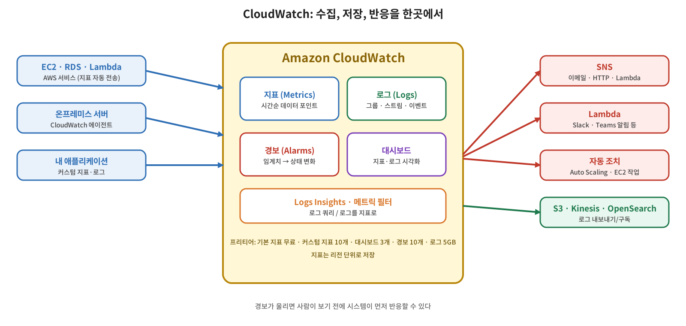

[S3 총정리](/2026/11/08/aws-s3-recap/)로 스토리지 챕터를 마무리했다. 이번 주제는 모니터링이다. 만든 서비스가 잘 돌아가는지, 사용자가 의도대로 쓰고 있는지, 문제가 없는지는 측정해야 알 수 있다. AWS에서 이 측정을 맡는 서비스가 **Amazon CloudWatch**다. 이번 글에서는 CloudWatch가 무엇을 하는지 전체 그림을 잡고, 이어지는 세 편에서 지표, 로그, 경보를 하나씩 본다.

## 개념: CloudWatch란

CloudWatch는 AWS 리소스와 애플리케이션의 **지표, 로그, 이벤트 같은 운영 데이터를 수집해서 시각화하고, 경보로 자동 대응까지 연결하는 모니터링·관찰 서비스**다. 거의 모든 AWS 서비스와 기본으로 연동되어 있어서, EC2의 CPU 사용률, RDS의 디스크 사용량, Lambda의 실행 시간과 호출 횟수처럼 "이게 잘 돌고 있나"를 확인하려면 대부분 CloudWatch를 떠올리면 된다.

CloudWatch는 인터넷으로 접근하는 퍼블릭 서비스다. 인터넷 경로가 없는 격리된 VPC에서 쓰려면 인터페이스 엔드포인트가 필요하다. 데이터를 보내는 쪽도 AWS 서비스에 한정되지 않는다. 온프레미스 서버나 내가 만든 애플리케이션도 CloudWatch 에이전트나 API로 지표와 로그를 보낼 수 있다.

## 개념: 주요 기능

| 기능 | 하는 일 |
|---|---|
| **지표(Metrics)** | 시간 순서로 쌓이는 데이터 포인트의 집합. AWS 서비스는 별도 설정 없이 기본 지표를 보낸다. 직접 정의한 값(접속 횟수, 404 횟수 등)을 **커스텀 지표**로 보낼 수도 있다 |
| **경보(Alarms)** | 지표 값이 임계치를 넘거나 내려가면 알림을 만들고 자동 대응을 실행한다 |
| **로그(Logs)** | Lambda, EC2, Route 53, ECS 등 여러 서비스와 온프레미스의 로그를 모아 저장하고 검색한다. S3, Kinesis, OpenSearch 같은 다른 곳으로 보낼 수도 있다 |
| **대시보드** | 지표와 로그를 한 화면에 모아 보여 준다. 위젯으로 외부 공유용 화면도 구성할 수 있다 |
| **Logs Insights** | 쌓인 로그를 쿼리로 분석한다. 전문 로그 분석 서비스만큼 강력하지는 않지만 일반적인 용도에는 충분하다 |

이 밖에 웹 애플리케이션을 주기적으로 점검하는 Synthetics, 컨테이너와 Lambda의 문제를 찾아 주는 Insights 계열 서비스 등이 있다. 기초 단계에서는 지표, 로그, 경보가 핵심이다.

## 개념: 경보가 중요한 이유

장애 대응에서 첫 단계는 **얼마나 빨리 알아채는가**다. 1분 안에 복구할 수 있는 장애라도 20시간 뒤에 알았다면 이미 피해가 난 뒤다. 경보는 "웹 서버의 500 에러가 일정 수치를 넘으면 Slack으로 알림" 같은 구성을 가능하게 해서, 사람이 화면을 지켜보지 않아도 이상을 먼저 알려 준다. 알림 전달에는 보통 SNS를 거치고, 그 뒤에 이메일, Lambda, HTTP 엔드포인트 등을 연결한다.

## 개념: 요금과 프리티어

CloudWatch 프리티어(공식 가격 페이지 기준)는 다음과 같다.

| 항목 | 무료 범위 |
|---|---|
| 기본 모니터링 지표 | AWS 서비스가 자동으로 보내는 지표는 무료 |
| 커스텀·상세 모니터링 지표 | 10개 |
| 대시보드 | 사용자 정의 대시보드 3개(각 지표 50개까지) |
| 경보 | 표준 해상도 경보 지표 10개 |
| 로그 | 5GB (수집, 아카이브 저장, Logs Insights 스캔 합산) |

이 범위를 넘으면 지표 수, 경보 수, 로그 수집·저장량, API 요청 수 등에 따라 요금이 붙고, 기능마다 과금 방식이 조금씩 다르다. 특히 커스텀 지표를 디멘션 조합별로 많이 만들거나 로그를 대량으로 수집하면 비용이 빠르게 늘어난다.

## 용어 정리

| 용어 | 설명 |
|---|---|
| CloudWatch | AWS의 지표·로그·경보를 다루는 모니터링 서비스 |
| 지표(Metric) | 시간 순서로 정리된 데이터 포인트의 집합 |
| 커스텀 지표 | 사용자가 직접 정의해서 CloudWatch에 보내는 지표 |
| 경보(Alarm) | 지표가 임계치를 벗어나면 알림이나 자동 조치를 실행하는 기능 |
| 로그 | 애플리케이션·서비스가 남긴 기록. CloudWatch Logs에 모아서 검색·분석 |
| Logs Insights | CloudWatch 로그를 쿼리로 분석하는 기능 |
| 대시보드 | 지표와 로그를 모아 보여 주는 화면 |
| SNS | 경보 알림을 여러 대상으로 전달하는 AWS 알림 서비스 |
