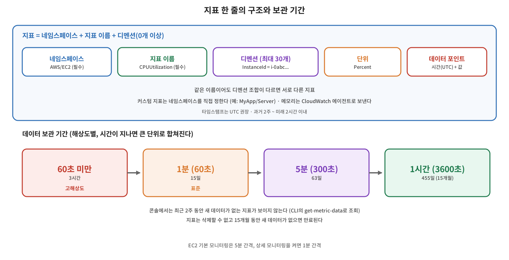

[CloudWatch 기초](/2026/11/09/aws-cloudwatch-basics/)에서 CloudWatch의 가장 핵심 기능이 지표라고 했다. 이번 글에서는 지표 하나가 어떤 요소로 이루어져 있는지, 데이터가 얼마나 오래 남는지, 그리고 콘솔에서 지표가 보이지 않을 때 무엇을 의심해야 하는지를 정리한다.



## 개념: 지표와 데이터 포인트

지표는 **시간 순서로 정리된 데이터 포인트의 집합**이다. 데이터 포인트 하나는 시간과 값으로 이루어진다. EC2의 CPU 사용률, 네트워크, 디스크 I/O 같은 지표는 설정 없이 서비스를 쓰는 순간부터 확인할 수 있다. 반대로 온프레미스 서버의 지표나 EC2의 **메모리 사용량**은 기본으로 제공되지 않으므로, CloudWatch 에이전트 등으로 직접 보내야 하는 **커스텀 지표**다. EC2의 `AWS/EC2` 네임스페이스에는 메모리·디스크 사용률 지표가 없다.

지표는 **리전 단위**로 저장되고, 만든 리전에서만 보인다. 지표는 삭제할 수 없고, 15개월 동안 새 데이터가 들어오지 않으면 만료된다.

## 개념: 지표를 식별하는 요소

지표는 **네임스페이스, 지표 이름, 0개 이상의 디멘션**으로 고유하게 정해진다.

| 요소 | 설명 |
|---|---|
| **네임스페이스** | 지표를 논리적으로 묶는 컨테이너. 필수이고 기본값이 없다. AWS 서비스 지표는 `AWS/서비스명`(예: `AWS/EC2`, `AWS/RDS`) 형식이다. 커스텀 지표는 직접 정한다 |
| **지표 이름** | 무엇을 재는 지표인지 나타내는 이름. 필수 (예: `CPUUtilization`) |
| **디멘션** | 지표를 구분하는 이름·값 쌍(태그나 카테고리와 비슷). 지표 하나에 최대 30개 |
| **단위** | `Percent`, `Bytes`, `Seconds`, `Count` 등. 지정하지 않으면 `None` |

디멘션은 헷갈리기 쉬운 개념이다. `AWS/EC2` 네임스페이스에는 모든 인스턴스의 지표가 모이는데, `InstanceId` 디멘션을 지정하면 특정 인스턴스의 CPU만 골라서 볼 수 있다. 주의할 점은 **디멘션 조합이 다르면 서로 다른 지표**라는 것이다. 그리고 커스텀 지표는 디멘션 사이에 자동으로 합산되지 않는다.

커스텀 지표는 네임스페이스, 이름, 디멘션, 단위를 모두 직접 정한다. 예를 들어 메모리 사용률을 `MyApp/Server` 네임스페이스, `MemoryUtilization` 이름, `InstanceId`·`InstanceType` 디멘션, `Percent` 단위로 보낼 수 있다.

## 개념: 타임스탬프와 해상도

- 타임스탬프는 **초 단위**까지 지정할 수 있고, **UTC 사용이 권장**된다. 로컬 시간(KST 등)으로 보내면 경보나 통계와 어긋나서 알람이 늦게 울리거나 `INSUFFICIENT_DATA`가 뜨는 문제가 생길 수 있다. 과거 2주, 미래 2시간 이내의 시각만 허용된다.
- **해상도**는 데이터를 얼마나 자주 수집하는가다. 표준 해상도는 1분 간격이고, 고해상도(High Resolution) 지표는 1초 간격까지 가능하다. 고해상도 지표는 `PutMetricData` 호출마다 요금이 붙으므로 호출이 잦을수록 비용이 늘어난다.
- **EC2 기본 모니터링은 5분 간격**이고, 상세 모니터링을 켜면 1분 간격이다. 서비스 지표는 모두 1분 단위가 아니라는 점에 주의해야 한다.

## 개념: 기간(Period)과 통계

수집된 데이터 포인트를 조회할 때는 **기간(Period)** 단위로 묶고, 묶인 값에 평균·합계·최소·최대·샘플 수 같은 **통계**를 적용한다. 기간은 1초, 5초, 10초, 30초, 또는 60초의 배수로 정할 수 있고, 기본값은 60초다. 60초 미만의 기간은 고해상도 데이터가 있어야 의미가 있다. 퍼센타일 통계는 원본 데이터 포인트가 있어야 하고 음수 값이 있으면 쓸 수 없다.

## 개념: 보관 기간

데이터는 해상도에 따라 보관 기간이 다르고, 시간이 지나면 더 큰 단위로 합쳐진다.

| 해상도 | 보관 기간 |
|---|---|
| 60초 미만 (고해상도) | 3시간 |
| 60초 (1분) | 15일 |
| 300초 (5분) | 63일 |
| 3600초 (1시간) | 455일 (15개월) |

예를 들어 1분 단위 데이터는 15일이 지나면 5분 단위로만 볼 수 있고, 63일이 지나면 1시간 단위로만 남는다. 영구 보관이 아니므로 장기 분석이 필요하면 별도로 내보내야 한다.

## 주의: 콘솔에서 지표가 보이지 않을 때

**최근 2주 동안 새 데이터 포인트가 없는 지표는 콘솔에서 보이지 않고, `list-metrics` 결과에도 나오지 않는다.** 지표가 안 보이면 먼저 이 경우를 의심하면 된다. 이런 지표는 CLI의 `get-metric-data`나 `get-metric-statistics`로 조회할 수 있다.

```bash
aws cloudwatch get-metric-statistics \
  --namespace AWS/EC2 \
  --metric-name CPUUtilization \
  --dimensions Name=InstanceId,Value=i-1234567890abcdef0 \
  --start-time 2026-11-01T00:00:00Z --end-time 2026-11-02T00:00:00Z \
  --period 3600 --statistics Average
```

## 용어 정리

| 용어 | 설명 |
|---|---|
| 네임스페이스 | 지표를 묶는 컨테이너. 필수. AWS 지표는 `AWS/서비스명` |
| 지표 이름 | 지표의 고유 이름. 필수 |
| 디멘션 | 지표를 구분하는 이름·값 쌍. 최대 30개. 조합이 다르면 다른 지표 |
| 단위 | Percent, Bytes, Seconds, Count 등 |
| 데이터 포인트 | 시간과 값으로 이루어진 지표의 한 점 |
| 해상도 | 수집 간격. 표준 1분, 고해상도 1초 |
| 기간(Period) | 조회·평가 때 데이터 포인트를 묶는 시간 단위 |
| 기본 모니터링 / 상세 모니터링 | EC2 지표를 5분 / 1분 간격으로 수집 |
| 커스텀 지표 | 사용자가 직접 정의해서 보내는 지표(EC2 메모리 등) |
| CloudWatch 에이전트 | 서버 안의 메모리·디스크 등을 수집해 CloudWatch로 보내는 프로그램 |
