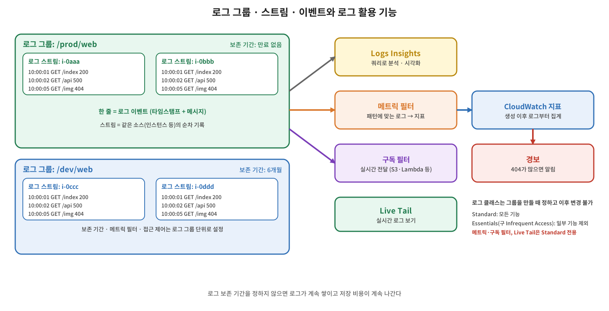

[지난 글](/2026/11/10/aws-cloudwatch-metrics/)의 지표가 "지금 상태가 어떤가"를 숫자로 보여 준다면, 로그는 "무슨 일이 있었는가"를 기록한다. CloudWatch Logs는 AWS 서비스와 온프레미스에서 모은 로그를 저장·관리·검색하는 서비스이고, CloudWatch 기능 중 가장 방대하다. Lambda처럼 로그를 기본으로 CloudWatch에 보내도록 되어 있는 서비스도 많다.

## 개념: 로그의 구성 요소

| 구성 요소 | 설명 |
|---|---|
| **로그 그룹** | 같은 보존·모니터링·접근 제어 설정을 공유하는 로그 스트림의 묶음. 보통 애플리케이션, 서비스, 리소스(예: Lambda 함수명, 환경별) 단위로 만든다. 설정의 기본 단위 |
| **로그 스트림** | 같은 소스에서 순서대로 들어온 로그 이벤트의 열. 예를 들어 웹 서버 클러스터에서 인스턴스 하나의 로그가 스트림 하나 |
| **로그 이벤트** | 타임스탬프와 메시지로 이루어진 기록 하나. 말 그대로 로그 한 줄 |
| **보존 기간** | 로그가 자동 삭제되기까지의 기간. 설정하지 않으면 만료되지 않고 계속 보관되며 그만큼 비용이 든다 |

그림처럼 개발용과 운영용 웹 애플리케이션이 있다면 로그 그룹을 둘로 나누고, 각 EC2 인스턴스마다 스트림을 만든다. 개발 그룹은 보존 6개월, 운영 그룹은 만료 없음처럼 **그룹 단위로 다른 정책**을 줄 수 있다. 보존 기간, 메트릭 필터, 접근 제어가 모두 로그 그룹에 붙는다.

## 개념: 로그 클래스

로그 그룹을 만들 때 **로그 클래스**를 고른다.

| 클래스 | 특징 |
|---|---|
| **Standard** | 기본값. 실시간 모니터링 등 모든 기능을 쓸 수 있다 |
| **Essentials** | 수집 단가가 더 낮은 대신 일부 기능을 쓸 수 없다. 이전에는 Infrequent Access라고 불렀고, 현재 문서에서는 이름이 Essentials로 바뀌었다(API 입력으로는 두 이름 모두 허용) |

두 클래스 모두 KMS 암호화, S3 내보내기, 민감 데이터 마스킹 등을 지원하지만, 다음 기능은 **Standard에서만** 쓸 수 있다: 메트릭 필터, 구독 필터, Live Tail, 이상 탐지, 필드 인덱싱, `GetLogEvents`·`FilterLogEvents` API, Container Insights·Lambda Insights 로그 수집, 임베디드 메트릭 형식. Logs Insights 쿼리는 Essentials에서도 되지만 일부 쿼리 명령은 지원되지 않는다. 가장 중요한 제약은 **로그 그룹을 만든 뒤에는 로그 클래스를 바꿀 수 없다**는 것이다. 처음 만들 때 신중하게 정해야 하고, 경보나 필터를 붙일 로그라면 Standard여야 한다.

## 개념: Logs Insights

CloudWatch Logs Insights는 **로그를 대화식으로 쿼리해서 분석하는 기능**이다. 로그가 올라오는 대로 필드가 자동으로 인식되고, 데이터베이스에 질의하는 것과 비슷하게 조건으로 거르고 집계해서 결과를 볼 수 있다. 쿼리를 저장하거나 결과를 대시보드로 시각화할 수 있다. OpenSearch 같은 전문 로그 분석 서비스에는 못 미치지만 일반적인 분석은 대부분 이 기능으로 충분하다. 요금 측면에서는 스캔한 데이터 양이 과금되므로, 시간 범위와 로그 그룹을 좁혀서 쓰는 것이 좋다.

## 개념: 메트릭 필터

**메트릭 필터는 로그에서 패턴에 맞는 이벤트를 찾아 CloudWatch 지표로 바꿔 준다.** 예를 들어 웹 로그에서 상태 코드가 404인 이벤트의 수를 지표로 만들면, 그 지표에 경보를 걸어서 404가 급증할 때 알림을 받는 구조를 만들 수 있다. 필터 패턴은 비교 연산이나 정규식까지 쓸 수 있고, 지표 값으로는 일치 횟수(1씩)나 로그에 있는 숫자(전송 바이트 등)를 쓴다.

알아 둘 점은 다음과 같다.

- 필터는 **만든 이후에 들어오는 로그만** 지표로 만든다. 이전 로그는 소급해서 지표가 되지 않는다.
- 일치하는 로그가 없는 기간에도 값을 남기려면 **기본값**을 0으로 지정한다. 지정하지 않으면 그 기간의 지표 값이 비어 경보 평가 때 데이터가 없는 상태가 될 수 있다. 디멘션을 지정하면 기본값은 지정할 수 없다.
- 메트릭 필터는 **Standard 로그 그룹에서만** 지원된다.

## 개념: 그 밖의 기능

| 기능 | 설명 |
|---|---|
| **Live Tail** | 올라오는 로그를 실시간으로 본다. 콘솔과 CLI에서 사용 |
| **이상 탐지** | 머신러닝으로 로그 그룹의 평소 패턴에서 벗어난 로그를 찾아 준다 |
| **구독 필터** | 로그를 실시간으로 다른 서비스나 계정으로 보낸다. S3 백업, 로그 전용 계정으로 이관, OpenSearch 같은 분석 서비스 연동 등에 쓰며 필터링도 가능 |

## 용어 정리

| 용어 | 설명 |
|---|---|
| 로그 그룹 | 보존·접근 제어·필터 설정을 공유하는 로그 스트림의 묶음 |
| 로그 스트림 | 같은 소스에서 순서대로 들어온 로그 이벤트의 열 |
| 로그 이벤트 | 타임스탬프와 메시지로 된 로그 한 건 |
| 보존 기간 | 로그가 자동 삭제되기까지의 기간 |
| 로그 클래스 | Standard(모든 기능)와 Essentials(구 Infrequent Access, 일부 기능 제외, 생성 후 변경 불가) |
| Logs Insights | 로그를 쿼리로 분석하는 기능 |
| 메트릭 필터 | 패턴에 맞는 로그를 지표로 바꾸는 기능. 생성 이후 로그만 대상 |
| 구독 필터 | 로그를 실시간으로 다른 대상에 전달하는 기능 |
| Live Tail | 로그를 실시간으로 보는 기능 |
