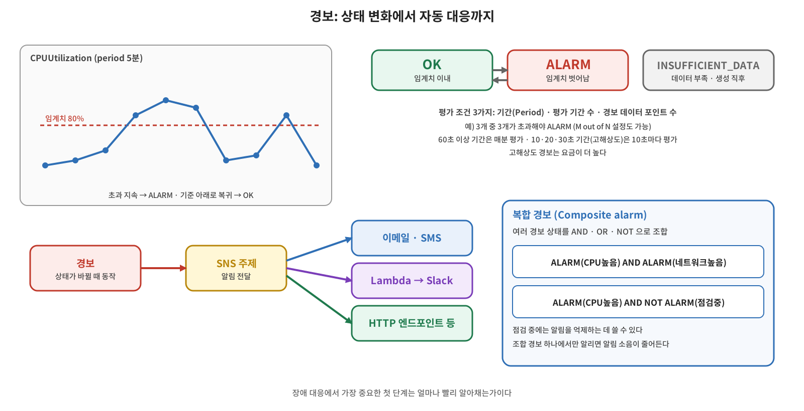

[지표](/2026/11/10/aws-cloudwatch-metrics/)와 [로그](/2026/11/11/aws-cloudwatch-logs/)를 모았으니 이제 그 값을 보고 반응할 차례다. CloudWatch 경보는 지표가 정해 둔 임계치(Threshold)를 넘거나 내려갔을 때 알림을 만들고 다음 동작으로 연결한다. 이번 글은 개념 위주로 정리하고, 실제 구성은 별도 실습에서 다룬다.



## 개념: 경보의 세 가지 상태

| 상태 | 의미 |
|---|---|
| **OK** | 지표가 임계치 이내로 정상 |
| **ALARM** | 지표가 임계치를 벗어난 상태 |
| **INSUFFICIENT_DATA** | 경보를 막 만들었거나, 지표를 쓸 수 없거나, 상태를 판단할 데이터가 부족한 상태 |

경보를 만든 직후에는 `INSUFFICIENT_DATA`를 자주 보게 된다. 지표를 수집하는 쪽이 잘못된 타임스탬프를 보내거나(예: UTC가 아닌 시각) 데이터가 끊긴 경우에도 이 상태가 될 수 있다.

## 개념: 평가 방식

경보를 만들 때 세 가지를 정한다.

- **기간(Period)**: 지표를 한 데이터 포인트로 묶는 시간(초)
- **평가 기간 수(Evaluation Periods)**: 상태를 판단하려고 살펴보는 최근 데이터 포인트의 수
- **경보 데이터 포인트 수(Datapoints to Alarm)**: 그중 임계치를 벗어나야 `ALARM`이 되는 개수

예를 들어 기간 5분, 평가 기간 수 3, 경보 데이터 포인트 수 3이라면 최근 15분 동안 세 번 모두 임계치를 넘어야 경보가 울린다. 일시적으로 한 번 튄 값에는 반응하지 않는다. 평가 기간 수와 경보 데이터 포인트 수를 다르게 두면 "N개 중 M개" 방식이 된다. 기간이 1분 이상이면 경보는 **매분** 평가되며, 이때 평가 구간은 최근 기간 × 평가 기간 수만큼을 미끄러지듯 이동한다. 또 누락된 데이터를 어떻게 취급할지도 설정할 수 있다.

## 개념: 지표 해상도와 경보 주기

경보 기간은 **지표를 수집하는 해상도보다 짧을 수 없다**. EC2 기본 모니터링(5분 지표)에 거는 경보는 기간이 300초 이상이어야 하고, 상세 모니터링(1분 지표)이라면 60초 이상이다. 60초 미만으로 정밀하게 평가하려면 고해상도 지표가 필요하다. 고해상도 지표에는 **10초, 20초, 30초 기간**의 고해상도 경보를 걸 수 있고, 이 경보는 10초마다 평가되며 요금이 더 높다. 60초 이상의 기간은 60초의 배수로 정한다.

## 개념: 알림과 자동 대응

경보 상태가 바뀌면 작업을 실행할 수 있다. 대표적으로 **SNS 주제**로 알림을 보내면, SNS가 이메일, SMS, HTTP 엔드포인트, Lambda 등 여러 대상에 전달한다. Lambda를 연결하면 Slack, Teams, Telegram 같은 외부 메신저로 알림을 보낼 수 있다. EC2 인스턴스에 이상이 생기면 다른 인스턴스를 띄우는 Auto Scaling 정책을 실행하는 식의 자동 대응도 가능하다. SNS 자체는 별도 주제로 따로 정리한다.

## 개념: 복합 경보와 알림 억제

**복합 경보(Composite alarm)** 는 다른 경보들의 상태를 **불리언 식으로 조합**해서 만드는 경보다. 규칙에는 `ALARM("이름")`, `OK("이름")`, `INSUFFICIENT_DATA("이름")` 함수와 `AND`, `OR`, `NOT` 연산자, 괄호를 쓴다.

```
ALARM(CPU높음) AND ALARM(네트워크높음)
ALARM(CPU높음) AND NOT ALARM(점검중)
```

첫 번째 식은 두 경보가 동시에 울릴 때만 알리고, 두 번째 식은 점검 중에는 CPU 경보를 무시한다. 여러 경보 결과를 하나로 합쳐서 전달하므로 **알림 소음이 줄고**, 팀별로 "웹 서버 CPU 경보 또는 RDS CPU 경보일 때만" 같이 다른 조건을 줄 수 있다. 하나의 복합 경보는 최대 100개의 하위 경보를 참조할 수 있고, 하위 경보는 같은 계정·리전에 있어야 한다(교차 계정 관측성의 모니터링 계정은 예외). 복합 경보가 실행할 수 있는 작업은 SNS 알림, Lambda 호출, Systems Manager OpsItem·Incident Manager 인시던트 생성이다.

복합 경보에는 **작업 억제(Actions suppressor)** 도 있다. 억제 경보를 지정해 두면 그 경보가 `ALARM` 상태인 동안 복합 경보의 작업이 실행되지 않는다. 점검 기간처럼 알림이 울리는 것이 당연한 때에 일시적으로 알림을 끄는 용도다. 억제 경보가 `ALARM`에 들어가기를 기다리는 시간(`ActionsSuppressorWaitPeriod`)과, `ALARM`에서 벗어난 뒤 작업 실행을 늦추는 연장 시간(`ActionsSuppressorExtensionPeriod`)을 함께 정한다.

## 용어 정리

| 용어 | 설명 |
|---|---|
| 임계치(Threshold) | 경보 상태를 바꾸는 기준값 |
| OK / ALARM / INSUFFICIENT_DATA | 경보의 세 가지 상태 |
| 기간(Period) | 지표를 한 데이터 포인트로 묶는 시간 |
| 평가 기간 수 | 상태 판단에 쓰는 최근 데이터 포인트 수 |
| 경보 데이터 포인트 수 | 그중 임계치를 넘어야 하는 개수 |
| 고해상도 경보 | 10·20·30초 기간으로 평가하는 경보. 요금이 더 높음 |
| SNS | 경보 알림을 여러 대상에 전달하는 서비스 |
| 복합 경보 | 다른 경보의 상태를 AND·OR·NOT으로 조합한 경보 |
| 작업 억제 | 억제 경보가 ALARM인 동안 복합 경보의 작업을 막는 기능 |
